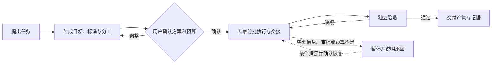

# DeepSeek Super Agent Longtask

**让长任务有计划地执行，也有依据地结束。**

基于 DeepSeek 团队发布的 [Super Agent 架构](https://github.com/deepseek-ai/dsh-superagent-prototype/blob/main/docs/003-execution.md)开发的 DSH 长任务插件。它帮助你把复杂目标拆成可确认的计划，协调执行者，在预算内推进任务，并由独立验收者检查结果。

`0.1.2-rc.19` · 发布候选版 · Node.js ≥ 22 · 需要 DSH 宿主

> 当前版本仍在完善实机验收。金额是依据模型用量和价格表计算的估算值，不等同于平台账单。使用前请阅读[安装与验收边界](./dsh-longtask/RELEASE.md)。

## 为什么需要它？

一个任务做得越久，越容易遇到这些问题：执行中断后不知道从哪里继续；多个专家之间的交付物和责任不清楚；模型说“完成了”，却没有实际检查；最后还很难核对花费。

Longtask 把这些环节放进同一个任务流程：**开工前确认，执行中留痕，遇到问题暂停，验收通过后交付。**

## 它能做什么

| 能力 | 你会得到什么 |
| --- | --- |
| 计划与分工 | 开工前确认目标、完成标准、交付路径、专家职责和预算；可调整方案和人选 |
| 多专家协作 | 按业务模块和批次推进，记录交接与依赖；专家可以兼任，也可以共同完成一项标准 |
| 预算与用量 | 用户填写人民币总上限；托管执行、验收和返工共用任务账本，请求前预留、返回后按用量核算 |
| 等待与恢复 | 支持暂停、恢复、等待后台命令和工具审批；费用或投递结果不明确时暂停核对 |
| 独立验收 | 区分静态审阅、命令检查和浏览器检查；需要实测的标准须关联对应计划和运行记录 |
| 交付与复验 | 记录验收结论、产物哈希与证据；已交付任务可确认补测计划，沿用原任务和预算重开验收 |

专家推荐使用本地专家库的关键词和元数据，不额外调用模型。推荐结果是分工参考，需要结合任务实际判断。

## 工作流程



## 使用示例

安装并配置插件后，在 DSH 普通对话中提出需求，例如：

> 把比较两种存储方案作为长任务。请交付一份对比表和推荐结论，先给我完成标准、专家分工和验收方案，开工前让我填写人民币预算。

DSH 会先提出待确认方案。你可以修改目标、标准或分工；在确认面板中填写预算并提交后，任务才开始执行。模型给出的建议金额不会自动成为授权金额。

任务运行时，你可以直接询问或操作：

```text
列出我的长任务。
查看任务 task_… 的状态、成果和用量。
暂停任务 task_…。
恢复任务 task_…，沿用原预算。
取消任务 task_…。
```

Worker 等待工具审批时，请打开对应 Worker 的 DSH 审批卡片处理。主会话中的状态通知用于提醒，不会代替审批。

## 安装与配置

### 准备环境

- 已安装支持插件的 DSH 宿主；已核对的 SDK 版本为 `0.2.1-rc.5` 和 `0.2.2-rc.1`。
- Node.js **22 或更高版本**；开发和回归建议使用 Node.js 24。
- 本地专家定义目录：包含 `divisions.json` 和相应专家 Markdown 文件，通过 `agencyAgentsRoot` 配置。专家定义不随核心包内置。
- 一个存在的任务工作目录，以及宿主可用的模型、工具和确认通道。

### 从源码构建安装包

```sh
git clone https://github.com/Hjh-12138/deepseek-superagent-longtask.git
cd deepseek-superagent-longtask/dsh-longtask
npm ci --ignore-scripts
npm run build
npm pack
```

在 DSH 中通过宿主的本地插件包安装入口选择生成的 `dsh-plugin-longtask-*.tgz`，并根据[配置示例](./dsh-longtask/release/config.example.yml)设置数据目录、专家库、工作目录、模型及价格。安装后完整退出并重启 DSH。

升级已有安装前，请备份数据目录、配置和旧安装包。完整步骤见[安装、升级与发布验收](./dsh-longtask/RELEASE.md)。

## 预算与验收：需要知道的边界

- **预算是任务账本，不是平台硬限额。** 托管执行、验收和返工共用任务预算；用户主会话及第三方付费工具不计入该账本。部分宿主或供应商的输入开销可能不可观测。
- **价格需要维护。** 内置价格有适用模型和有效期；价格缺失或过期时，金额任务会暂停，需核对配置。
- **验收记录证明检查已执行，不保证测试覆盖充分。** 独立验收者仍需审查检查脚本和断言是否覆盖用户要求。
- **浏览器能力由环境提供。** 浏览器检查需要项目准备实际自动化脚本、依赖和浏览器环境；插件不内置或自动下载浏览器。
- **无法安全确认时会暂停。** 例如费用待核对、投递结果未知或验收能力不足，需要查看原因并处理后再继续。

## 开发与测试

```sh
cd deepseek-superagent-longtask/dsh-longtask
npm ci --ignore-scripts
npm test
```

测试不调用真实模型，也不需要账号凭证。当前核心源码的离线回归记录为 **415 项：414 通过、0 失败、1 项可选真实专家库扫描跳过**。如需验证实际专家库，可设置 `DSH_LONGTASK_TEST_EXPERTS_ROOT`；未设置时跳过该项。离线测试不能代替完整桌面实机验收。

仓库中的 [Windows / Node.js 24 CI](./.github/workflows/ci.yml) 会运行安装、测试和打包检查。运行数据、真实会话、机器配置及历史实机报告不随源码发布。

## 文档导航

- [核心插件功能与操作](./dsh-longtask/README.md)：正式工具、任务管理、分工和验收机制。
- [安装、升级与发布验收](./dsh-longtask/RELEASE.md)：安装要求、升级回退和已验证范围。
- [配置示例](./dsh-longtask/release/config.example.yml)：模型、预算、工作目录及运行参数。
- [更新记录](./dsh-longtask/CHANGELOG.md)：各候选版本的变更和验证记录。
- [DeepSeek Harness 架构](https://github.com/deepseek-ai/deepseek-harness/blob/master/docs/architecture.md)：宿主架构说明。
